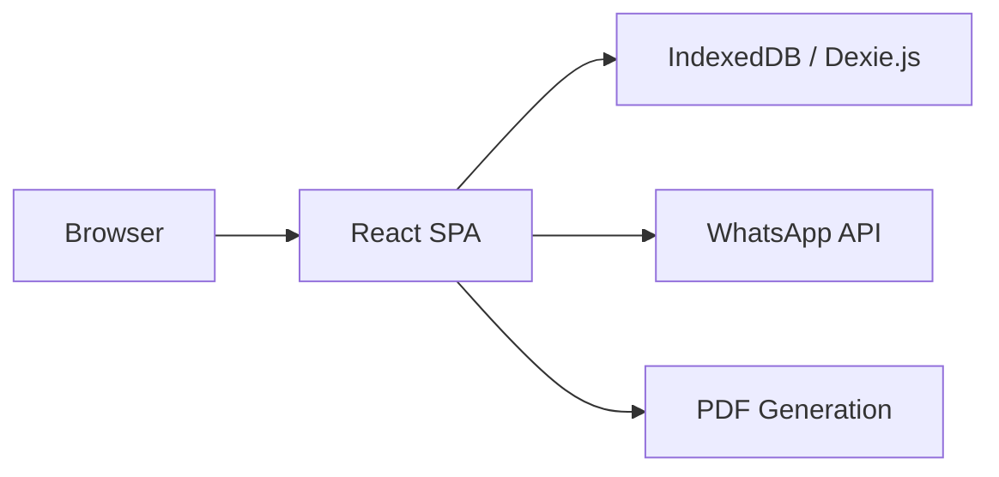

# SATRIA — Tech Stack

> **Sistem ATK Terintegrasi & Akurat**
> BPS Kota Jakarta Selatan

---

## Arsitektur Aplikasi

SATRIA adalah **Single Page Application (SPA)** yang berjalan sepenuhnya di sisi client (browser). Tidak ada backend server tradisional — semua data disimpan di **IndexedDB** browser pengguna melalui library Dexie.js.



---

## Frontend

| Teknologi            | Versi | Fungsi                           |
| -------------------- | ----- | -------------------------------- |
| **React**            | 19.2  | UI library utama                 |
| **TypeScript**       | 5.9   | Type-safe JavaScript             |
| **Vite**             | 7.2   | Build tool & dev server          |
| **TailwindCSS**      | 4.x   | Utility-first CSS framework      |
| **React Router DOM** | 7.12  | Client-side routing & navigation |
| **Lucide React**     | 0.562 | Icon library                     |

---

## Database

### Apa itu IndexedDB?

**IndexedDB** adalah database NoSQL bawaan setiap browser modern (Chrome, Firefox, Edge, Safari). Berbeda dari database tradisional seperti MySQL/PostgreSQL yang berjalan di server, IndexedDB berjalan **langsung di browser pengguna**.

| Aspek                        | IndexedDB                            | Database Tradisional (MySQL/PostgreSQL) |
| ---------------------------- | ------------------------------------ | --------------------------------------- |
| Lokasi                       | Di browser pengguna                  | Di server                               |
| Akses                        | Hanya dari browser yang sama         | Dari mana saja via jaringan             |
| Kapasitas                    | ~50MB–unlimited (tergantung browser) | Tergantung server                       |
| Koneksi internet             | ❌ Tidak perlu                       | ✅ Perlu                                |
| Sinkronisasi antar perangkat | ❌ Tidak bisa                        | ✅ Bisa                                 |

### Dexie.js — ORM untuk IndexedDB

Aplikasi ini menggunakan **Dexie.js v4.2** sebagai wrapper/ORM agar pengelolaan IndexedDB lebih mudah. Dexie menyediakan API mirip database relasional (query, filter, index) di atas IndexedDB yang secara native sulit digunakan langsung.

- **Nama Database**: `ATKManagementDB`
- **Versi Saat Ini**: v12 (dengan migration otomatis)
- **File Schema**: [`src/lib/db.ts`](file:///c:/atk3171/atk-app/src/lib/db.ts)

### Schema Tabel

Berikut seluruh tabel beserta kolom dan index-nya:

#### 1. `users` — Data Pengguna

| Kolom           | Tipe          | Keterangan                                                         |
| --------------- | ------------- | ------------------------------------------------------------------ |
| `id`            | number (auto) | Primary key                                                        |
| `nip`           | string        | NIP pegawai (indexed)                                              |
| `username`      | string        | Username untuk login (indexed)                                     |
| `name`          | string        | Nama lengkap                                                       |
| `password_hash` | string        | Hash password (SHA-256)                                            |
| `role`          | string[]      | Array role: admin, operator, pegawai, verifikator, penanggungjawab |
| `work_unit`     | string        | Unit kerja (indexed)                                               |
| `created_at`    | string        | Waktu pembuatan (ISO 8601)                                         |

#### 2. `atk_items` — Master Barang ATK

| Kolom        | Tipe          | Keterangan                  |
| ------------ | ------------- | --------------------------- |
| `id`         | number (auto) | Primary key                 |
| `item_code`  | string        | Kode barang (16 digit)      |
| `name`       | string        | Nama barang (indexed)       |
| `unit`       | string        | Satuan (rim, pcs, box, dll) |
| `created_at` | string        | Waktu pembuatan             |

#### 3. `requests` — Permintaan ATK

| Kolom                  | Tipe          | Keterangan                                                                       |
| ---------------------- | ------------- | -------------------------------------------------------------------------------- |
| `id`                   | number (auto) | Primary key                                                                      |
| `document_number`      | string        | Nomor dokumen (indexed)                                                          |
| `requester_id`         | number        | FK ke users (indexed)                                                            |
| `items`                | RequestItem[] | Array barang yang diminta                                                        |
| `status`               | string        | pending_verification, revision_requested, verified, approved, rejected (indexed) |
| `submission_date`      | string        | Tanggal pengajuan                                                                |
| `submission_location`  | string        | Lokasi pengajuan                                                                 |
| `fungsi_bagian`        | string        | Fungsi/bagian pemohon                                                            |
| `requester_signature`  | string        | Tanda tangan pemohon (base64)                                                    |
| `verifier_id`          | number        | FK ke users (verifikator)                                                        |
| `verifier_signature`   | string        | Tanda tangan verifikator (base64)                                                |
| `supervisor_id`        | number        | FK ke users (penanggung jawab)                                                   |
| `supervisor_signature` | string        | Tanda tangan approval (base64)                                                   |
| `created_at`           | string        | Waktu pembuatan (indexed)                                                        |

#### 4. `purchases` — Pembelian Barang

| Kolom             | Tipe          | Keterangan                    |
| ----------------- | ------------- | ----------------------------- |
| `id`              | number (auto) | Primary key                   |
| `document_number` | string        | Nomor nota/kwitansi (indexed) |
| `purchase_date`   | string        | Tanggal pembelian (indexed)   |
| `vendor_name`     | string        | Nama toko/vendor (indexed)    |
| `total_amount`    | number        | Total keseluruhan             |
| `receipt_file`    | string        | File nota (base64 PDF/JPG)    |
| `created_by`      | number        | FK ke users (indexed)         |

#### 5. `purchase_items` — Detail Barang per Pembelian

| Kolom         | Tipe          | Keterangan                |
| ------------- | ------------- | ------------------------- |
| `id`          | number (auto) | Primary key               |
| `purchase_id` | number        | FK ke purchases (indexed) |
| `item_name`   | string        | Nama barang (indexed)     |
| `quantity`    | number        | Jumlah                    |
| `unit`        | string        | Satuan                    |
| `unit_price`  | number        | Harga satuan              |
| `total`       | number        | Subtotal                  |

#### 6. `atk_requests` — Permohonan Pengadaan ATK

| Kolom             | Tipe          | Keterangan                            |
| ----------------- | ------------- | ------------------------------------- |
| `id`              | number (auto) | Primary key                           |
| `document_number` | string        | Nomor request (indexed)               |
| `requester_id`    | number        | FK ke users (indexed)                 |
| `reason`          | string        | Alasan pengadaan                      |
| `status`          | string        | pending, approved, rejected (indexed) |
| `reviewed_by`     | number        | FK ke users (admin yang review)       |

#### 7. `atk_request_items` — Detail Item Permohonan

| Kolom         | Tipe          | Keterangan                                |
| ------------- | ------------- | ----------------------------------------- |
| `id`          | number (auto) | Primary key                               |
| `request_id`  | number        | FK ke atk_requests (indexed)              |
| `item_name`   | string        | Nama barang (indexed)                     |
| `category`    | string        | Kategori                                  |
| `quantity`    | number        | Jumlah                                    |
| `is_new_item` | boolean       | Barang baru (bukan dari master) (indexed) |

#### 8. `initial_balances` — Saldo Awal

| Kolom        | Tipe          | Keterangan               |
| ------------ | ------------- | ------------------------ |
| `id`         | number (auto) | Primary key              |
| `item_name`  | string        | Nama barang (indexed)    |
| `unit`       | string        | Satuan                   |
| `quantity`   | number        | Jumlah saldo awal        |
| `unit_price` | number        | Harga satuan             |
| `year`       | number        | Tahun anggaran (indexed) |

#### 9. `stock_opnames` — Stok Opname Bulanan

| Kolom             | Tipe          | Keterangan                |
| ----------------- | ------------- | ------------------------- |
| `id`              | number (auto) | Primary key               |
| `item_name`       | string        | Nama barang (indexed)     |
| `system_quantity` | number        | Jumlah menurut sistem     |
| `actual_quantity` | number        | Jumlah hasil opname fisik |
| `difference`      | number        | Selisih (actual - system) |
| `month`           | number        | Bulan 1-12 (indexed)      |
| `year`            | number        | Tahun (indexed)           |

#### 10. `transfer_masuk` + `transfer_masuk_items` — Transfer Barang Masuk

| Kolom Header      | Tipe   | Keterangan                 |
| ----------------- | ------ | -------------------------- |
| `document_number` | string | Nomor dokumen (indexed)    |
| `source_satker`   | string | Satker pengirim (indexed)  |
| `transfer_date`   | string | Tanggal transfer (indexed) |
| `bast_file`       | string | File BAST (base64 PDF/JPG) |

#### 11. `transfer_keluar` + `transfer_keluar_items` — Transfer Barang Keluar

| Kolom Header         | Tipe   | Keterangan                 |
| -------------------- | ------ | -------------------------- |
| `document_number`    | string | Nomor dokumen (indexed)    |
| `destination_satker` | string | Satker penerima (indexed)  |
| `transfer_date`      | string | Tanggal transfer (indexed) |
| `bast_file`          | string | File BAST (base64 PDF/JPG) |

#### 12. `audit_log` — Log Audit

| Kolom        | Tipe          | Keterangan               |
| ------------ | ------------- | ------------------------ |
| `id`         | number (auto) | Primary key              |
| `request_id` | number        | FK ke requests (indexed) |
| `user_id`    | number        | FK ke users (indexed)    |
| `action`     | string        | Jenis aksi               |
| `details`    | object        | Detail perubahan         |
| `timestamp`  | string        | Waktu aksi (indexed)     |

#### 13. `settings` — Pengaturan Aplikasi

| Kolom             | Tipe   | Keterangan               |
| ----------------- | ------ | ------------------------ |
| `id`              | number | Primary key (selalu = 1) |
| `org_name`        | string | Nama organisasi          |
| `logo_url`        | string | URL logo                 |
| `budget_year`     | string | Tahun anggaran           |
| `doc_format`      | string | Format nomor dokumen     |
| `whatsapp_number` | string | Nomor WA notifikasi      |
| `official_name`   | string | Nama pejabat             |
| `official_nip`    | string | NIP pejabat              |
| `official_job`    | string | Jabatan pejabat          |
| `address`         | string | Alamat satker            |
| `city`            | string | Kota                     |

### Keamanan Password

Password pengguna di-hash menggunakan **SHA-256** dengan salt statis sebelum disimpan:

```
password + "atk_salt_2025" → SHA-256 → hex string
```

### Seed Data

Saat pertama kali dibuka, database otomatis diisi dengan:

- **5 user demo** (admin, verifikator, penanggungjawab, pegawai, operator)
- **15 master barang ATK** (kertas, pulpen, staples, dll)
- **1 record settings** default untuk BPS Kota Jakarta Selatan

### Versioning & Migration

Database sudah melalui **12 versi** migration, termasuk:

- v1: Tabel dasar (users, atk_items, requests, audit_log, settings)
- v4: Pemisahan purchases → purchases + purchase_items
- v5: Tambah tabel atk_requests & atk_request_items
- v6: Tambah tabel initial_balances & stock_opnames
- v8: Tambah tabel transfer_masuk & transfer_keluar
- v10: Rename role "supervisor" → "penanggungjawab", "pemohon" → "pegawai"
- v12: Tambah kolom `username` terpisah dari NIP

---

## Library Pendukung

| Library                    | Fungsi                                                    |
| -------------------------- | --------------------------------------------------------- |
| **xlsx** (SheetJS)         | Import/export file Excel (.xlsx) untuk data user & barang |
| **pdfjs-dist**             | Parsing file PDF (import data dari SAKTI)                 |
| **react-signature-canvas** | Tanda tangan digital untuk verifikasi & approval          |

---

## Struktur Folder

```
src/
├── components/         # Komponen reusable
│   ├── Layout.tsx      # Sidebar + navigasi utama
│   └── ProtectedRoute.tsx  # Route guard berdasarkan role
├── context/
│   └── AuthContext.tsx  # Autentikasi & session management
├── lib/
│   ├── db.ts           # Database schema & seed data (Dexie.js)
│   └── parseSaktiPDF.ts  # Parser PDF dari aplikasi SAKTI
├── pages/              # 29 halaman aplikasi
│   ├── Landing.tsx     # Landing page publik
│   ├── Login.tsx       # Halaman login
│   ├── Dashboard.tsx   # Dashboard utama
│   ├── NewRequest.tsx  # Form permintaan ATK baru
│   ├── Monitoring.tsx  # Monitoring stok real-time
│   ├── StockCard.tsx   # Kartu kendali persediaan
│   └── ...             # Dan halaman lainnya
├── App.tsx             # Root component & routing
├── main.tsx            # Entry point
└── index.css           # Global styles & Tailwind imports
```

---

## Fitur Utama

- 🔐 **Multi-role Authentication** — Admin, Operator, Pegawai, Verifikator, Penanggung Jawab
- 📝 **Permintaan ATK** — Form digital dengan workflow approval bertingkat
- ✅ **Verifikasi & Approval** — Dengan tanda tangan digital
- 📦 **Manajemen Stok** — Saldo awal, pembelian, transfer masuk/keluar, stok opname
- 📊 **Monitoring & Kartu Kendali** — Laporan persediaan real-time
- 📱 **Notifikasi WhatsApp** — Alert otomatis ke pihak terkait
- 📄 **Export Excel & PDF** — Cetak surat dan laporan
- 👥 **Kelola User** — Import/export via Excel

---

## Catatan Penting

> ⚠️ **Tidak ada backend server** — Semua data tersimpan di IndexedDB browser.
> Artinya data bersifat **lokal per perangkat** dan tidak tersinkronisasi antar komputer.
> Jika browser di-clear/reset, data akan hilang.
>
> Untuk deployment production, disarankan menambahkan backend (Node.js/Express + PostgreSQL atau Supabase) agar data tersentralisasi dan bisa diakses dari perangkat manapun.
